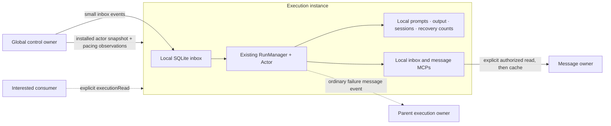

# Instance-owned execution draft

This draft changes the real follower startup and remote-actor path, following
[the prototype request](https://github.com/MEK-Org/rusa/issues/1020#issuecomment-6472108373)
and [the clarification to modify real code](https://github.com/MEK-Org/rusa/issues/1020#issuecomment-6472650796).
The earlier isolated sketch has been removed. Tests are untouched; no mesh
review or merge is requested. This is for assessing the responsibility boundary.

The main change is **where the existing coordinator lives**. `rusa start` on a
follower now composes an ordinary `ActorMesh`, its existing `RunManager` and
`Actor`, over its own SQLite inbox, sessions, focus and run records. The leader
supplies cached pacing information initially. Each executor owns admission,
prompt assembly, subprocess lifecycle and selected-work recovery. A leader
acknowledgement does not admit or finish a run.

## Read the diff in this order

1. [`commands/start-follower.ts`](../../../packages/rusa/src/commands/start-follower.ts)
   composes `ExecutionInstance` over this host's execution repositories and a
   loopback MCP server, then connects it to the existing `FollowerInstance`
   poll loop. Installed work is resumed locally before registration. Opening
   the local database reconciles interrupted open runs.
2. [`execution-instance.ts`](../../../packages/rusa/src/remote-instances/execution-instance.ts)
   supplies the existing local runtime with local provider admission, prompt
   construction, sessions, inbox MCP selection/handling, run accounting and
   `completedFocusEntryCounts`. The lifecycle stores results here. Failure
   uses the existing `routeRunFailure`; its diagnostic stays in a local
   message body, and its small ordinary event is addressed to the parent.
   Success sends no mandatory run-end event.
3. [`actor-projection.ts`](../../../packages/rusa/src/remote-instances/actor-projection.ts)
   replaces the leader's `ActorHandle` for a peer that negotiates this path.
   It installs control snapshots and hands off event references. It holds no
   admission ticket, run id, provider reservation or completion acknowledgement.
   `executionRead` obtains a timestamped state snapshot; it is a read, not a
   settlement operation.
4. [`e2e-adapter.ts`](../../../packages/rusa/src/remote-instances/e2e-adapter.ts)
   is also the production worker factory. The existing leader `start.ts`
   wires its inbox and pacing observations into the projection. The legacy
   handle/runtime remain for peers that do not negotiate instance execution.
5. [`follower-hub.ts`](../../../packages/rusa/src/remote-instances/follower-hub.ts)
   negotiates the additive draft capability, samples leader pacing at most
   once per 20 seconds, and routes ordinary instance events. The authenticated
   peer must own the sender; the sender must have the recipient handle or
   parent relationship. Incoming message envelopes are reconstructed without
   bodies. Explicit message reads check the requester is hosted on the peer
   and the origin checks participation in the message.
6. [`execution-actor-repository.ts`](../../../packages/rusa/src/remote-instances/execution-actor-repository.ts)
   stores installed foreign parent/address-book references in the existing
   versioned cache. The `actors` table has local foreign keys: copying a child
   alone otherwise requires copying its remote tree too. This small adapter
   avoids inventing peer actors or granting a follower global hierarchy writes.
   No schema or migration is changed.

## Event and entity boundary

The ordinary message notification carries its event identity, recipient,
source, timestamp, message id, origin instance, priority and delivery role.
It carries no message body, prompt or output. SQLite commits and deduplicates
it before the advisory local scheduling notification.

The message owner stores the body. `mesh-chat-read.get_message`, with the
origin instance from the inbox reference, reads it explicitly. On a follower,
the fetched result is cached under an origin-qualified key and checked against
its id and participants. A received event remains durable when its origin is
offline; uncached content is unavailable until that origin can answer. This is
[the accepted tradeoff](https://github.com/MEK-Org/rusa/issues/1020#issuecomment-6471920617).

The follower's existing authenticated poll/event channel transports these
operations. No direct peer database access is introduced. The capability is
advertised by `rusa start`; the standalone legacy follower entry point stays on
the legacy path. A leader needs an explicit `instance.id` to advertise the
new execution capability, so message origins have a stable configured name.

## Observed validation

A disposable synthetic harness exercised the actual `composeFollowerStart`,
`FollowerHub`, `ActorProjection` and `FollowerInstance`, separate leader/follower
SQLite databases, and the production loopback inbox/message MCP servers. Its
provider was synthetic: it invoked MCPs and returned outcomes without starting
an external provider CLI. The harness was not added to the test suite.

[The sanitized observations](observations.json) record:

- Two received notifications completed in two local runs after the leader
  gateway was closed during the first run. Local pending work became zero;
  the leader recorded zero runs. The handoff used only `quota`, `install`,
  `inbox`, `wake` and `executionRead` commands.
- A body fetched before disconnect remained readable from the local cache.
  The other, uncached body could not be fetched while the origin was offline.
- A later failed local run stored its diagnostic locally and queued one
  ordinary `mesh.message` event for the parent, containing a message reference
  and no diagnostic text.
- A deliberately unhandled selected entry reached two successful local
  returns and remained unhandled. Restarting actual follower composition over
  the same database, without connecting to the leader, preserved that count
  and launched no extra retry.

TypeScript checking and bundling the changed startup/worker paths were also
run. No tests were added, edited or run. Synthetic startup does not establish
real-provider, desktop or sandbox behavior.

## Deliberate gaps

- **Delivery:** the existing outgoing follower queue is still in memory and
  clears on leader-incarnation changes. Storing a body and enqueueing its event
  is not atomic. Leader-to-follower delivery replays retained source inbox
  copies; handled state is not yet projected back, so the leader's inbox view
  remains stale. A durable ordinary-event outbox and projection reconciliation
  remain work; neither should turn back into run-completion acknowledgement.
- **Control and tools:** installed actor metadata is a control snapshot, not
  global authority. This draft mounts local inbox and message tools only.
  Global obligations, attribution of external writes, brief/ledger tools and
  state, full spawn/retire/admin tools, grants, reply-handle introductions,
  placement transitions and remote recovery-clearance tools are not integrated.
  It does not decide a fresh-grant or disconnected-revocation policy implicitly.
- **Quota:** the leader supplies derived per-candidate pacing intervals, not
  account reservations. `observedAt` is the sampling time of that cached view.
  Full provider/model lane sharing, exhaustion/halt responses, quota freshness,
  persistence of observations and local scraping remain incomplete. A restarted
  executor currently starts without its old pacing observation. This draft
  makes no shared-account allocation guarantee.
- **Context and accounting:** native sessions and recent local output are
  wired. Portable brief/ledger parity, pending configuration transitions,
  token-accounting parity, crash timing and local accounting-write failures
  still need validation. The small metadata adapter is not an approved final
  storage design.
- **Reads and dashboard:** message fetch/cache is the implemented example.
  Run-detail reads, leader-side remote-message caching, overview refresh and
  freshness/offline presentation, event subscriptions and the separate live
  output stream remain unimplemented. The current projection can be stale;
  this draft does not claim dashboard correctness or appearance acceptance.
- **Compatibility:** capability negotiation retains the legacy path. Mixed
  releases, downgrade after local installation, reconnect/incarnation replay,
  protocol hardening and update/drain parity have not been established. Do not
  infer those guarantees from the successful synthetic run.

Moving to a managed database would change persistence without deciding execution
ownership. Keeping the old per-run handshake would retain the responsibility
boundary being reconsidered. This draft instead changes the real composition
while reusing the existing local runtime and exposing the unfinished seams.
