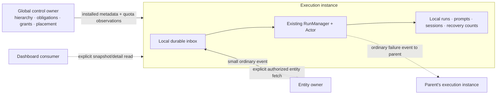

# Instance-owned execution prototype

This is the executable architecture sketch commissioned in
[#1020](https://github.com/MEK-Org/rusa/issues/1020#issuecomment-6472108373).
It explores the revised responsibility boundary from
[the design discussion](https://github.com/MEK-Org/rusa/issues/1020#issuecomment-6471920617).
It is a draft for evaluating the shape, not a replacement implementation ready
to merge. Tests are untouched and no mesh review is requested.

The main change is **where the existing coordinator lives**. An execution
instance gets an ordinary `ActorMesh`, hence its existing `RunManager` and
`Actor` machinery, over its own SQLite inbox and run records. The leader can
supply quota observations initially. Each executor owns the pacing clocks,
admission, prompt assembly, run lifecycle and selected-work recovery. There is
no per-run reserve/prepare/commit exchange with the leader.



## Read the code in this order

1. [`PrototypeInstance` construction](../../../packages/rusa/src/remote-instances/prototype/instance.ts)
   composes the existing local runtime. The local `completedFocusEntryCounts`
   callback is the important recovery boundary: receipt delivery is not an
   input. `submitPoolGate` and `ProviderPacer` are also existing primitives;
   there is no second scheduler implementation.
2. `receive` commits a small reference-bearing event to the destination inbox.
   The existing SQLite append handles duplicates and sends an advisory local
   wake after commit. A transport ACK would acknowledge that receipt, not a
   run's completion.
3. `sendMessage`, `serveMessage` and `readMessage` show a body stored on its
   origin, an event with a source reference, and an explicit authorized fetch
   into the recipient's local cache. Uncached content is unavailable while
   its origin is offline; a received notification still remains durable.
4. The local lifecycle subscriber stores run results. Success queues no leader
   message. Failure queues an ordinary parent notification containing only a
   run reference and failure status. Its delivery does not settle the run.
5. [`demo.ts`](../../../packages/rusa/src/remote-instances/prototype/demo.ts)
   composes two instances with separate real SQLite databases and deterministic
   providers. Peer transport is an in-process queue with an offline switch.

The new instance wrapper is an isolated composition root, analogous to the
current follower composition, rather than a new runtime abstraction. It exists
to make this ownership boundary readable without rewriting the daemon first.

## Run it

From the repository root, with the submodule initialized and dependencies installed:

```sh
pnpm --filter rusa exec tsup src/remote-instances/prototype/demo.ts --no-config --format esm --out-dir dist/instance-prototype --external better-sqlite3
node packages/rusa/dist/instance-prototype/demo.js
```

It creates disposable databases under a fresh temporary directory and prints
that directory in `demo_artifacts`. It never reads an installed instance's
configuration or state, connects to a provider, or invokes an external CLI.
The existing migration runner initializes these empty databases; no migration
or schema is added or changed by this prototype.

The structured output shows these scenarios:

| Record | What to inspect |
| --- | --- |
| `demo_finished_without_leader` | One completed executor run, zero unhandled entries, zero outgoing completion events while the leader is unreachable. |
| `demo_next_run_without_leader` | A second completed run under the same local coordinator, still without contacting the leader. |
| `demo_uncached_body_offline` | The inbox notification remains, its body is not cached, and failure queues an ordinary small parent event. |
| `demo_body_fetched_after_reconnect` | An explicit fetch caches the body; local reconciliation then handles the retained work. |
| `demo_recovery_budget_after_recreation` | The deliberately unhandled selection reaches two successful returns locally. Recreating the coordinator over the same database preserves that count and does not grant another retry. |

Delivery deliberately repeats every event; inbox deduplication prevents a
second durable copy. Eager message caching in the first two scenarios is
explicit demo setup, not default event content. The successful provider's
result includes the bodies it actually read, retained in the local database.

## What would change in the daemon

| Current boundary | Proposed boundary illustrated here |
| --- | --- |
| `start.ts` creates leader-side scheduling for remote actors; `actor-runtime.ts` asks the leader for `beforeRun`, `admit`, provider-attempt acknowledgement and completion. | Shared local runtime composition on either role. `start-follower.ts` supplies local stores and local actor-scoped tools instead of per-run RPC callbacks. |
| Leader inbox and run state drive remote execution. | Execution-owner inbox and run state drive execution. Global control state remains owned by its control service; installed metadata is a local read model. |
| A peer session participates in launch and completion bookkeeping. | Peer sessions carry ordinary event delivery, explicit reads and control operations. Losing a session changes availability, not a provider's observed termination. |
| Remote execution sends prompts/output or completion metadata to satisfy coordination. | Local retention, with small events only for interested consumers and explicit reads for content. Success needs no mandatory leader event. |
| Central scheduling owns quota reservations. | Initially the leader supplies quota observations; local pacers own starts. Observations are neither reservations nor a promise about other CLI usage. |

`snapshot()` is a bounded owner-side read showing how the dashboard can ask for
current state. It carries observation timestamps and no output. A production
overview would use cached snapshots with freshness/offline markers and refresh
asynchronously. Details query their owner, and live output is a separate
on-demand stream. This prototype implements neither dashboard wiring nor the
projection cache.

## Deliberate gaps

- **No daemon activation:** normal `start`, the current follower path and
  #1119 remain unchanged. The source is reached only through the command above.
  There is no negotiated wire change or N/N−1 compatibility implementation.
- **Transport:** the demo's outgoing queue is in memory. It does not survive a
  process crash, and storing a body plus enqueueing its event is not atomic.
  A durable ordinary-event outbox and authenticated, bounded ingress are still
  required; that delivery problem must not become a run-completion protocol.
  This demo does not establish network, retry, ACK or process-restart safety.
- **Control authority:** `install` is a manually supplied static snapshot, not
  a replicated global store or an actor API. No actor MCP tools are mounted.
  The reused mesh's mutable global APIs must not be exposed over this cache.
  Authority refresh, placement changes, new global mutations and stale-grant
  policy need integration. Offline autonomy cannot promise immediate remote
  revocation; the sketch does not decide that policy implicitly.
- **Quota:** observations contain only an illustrative derived pacing interval.
  There is no new scrape endpoint, production quota codec, exhaustion/halt
  handling, model-lane normalization, freshness policy or persistence of the
  observation. The last interval stays in memory while disconnected; after
  recreation this demo starts without one. Full quota policy belongs in the
  shared local composition, with its source replaceable by local scraping.
- **Entities:** only message bodies have fetch/cache wiring. Run references
  show the same shape, but run detail reads, owner-keyed cache identity,
  integrity checks, retention, fetch cancellation and live output are not
  implemented. The demo trusts its synthetic transport's requester identity.
- **Lifecycle:** the existing common actor implements runs and interruption,
  and local selected-work counters are real. Synthetic providers launch no
  subprocess. Crash/open-run reconciliation, token accounting, sandbox and
  desktop locks, native/portable context parity, attributed writes and MCP
  lifecycle composition are not demonstrated. The reused mesh still contains
  singleton-backed token accounting, which must become owner-local before
  this composition can serve real providers. Cross-instance exhausted-work
  escalation also needs to use ordinary delivery; this sketch only forwards
  provider failures. No termination/recovery guarantee is inferred from a
  peer disconnect.

Moving all state into a managed database would change persistence without
settling execution ownership. Keeping the existing per-run distributed
handshake would preserve the coordination boundary this prototype is meant to
reconsider. This sketch therefore reuses the local runtime and makes the
remaining transport/control work explicit rather than completing either of
those alternatives.
