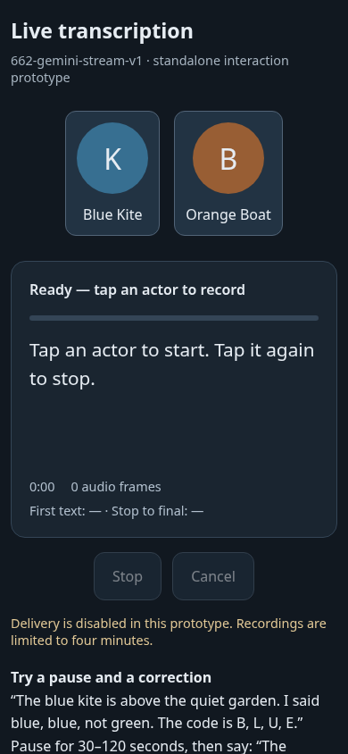
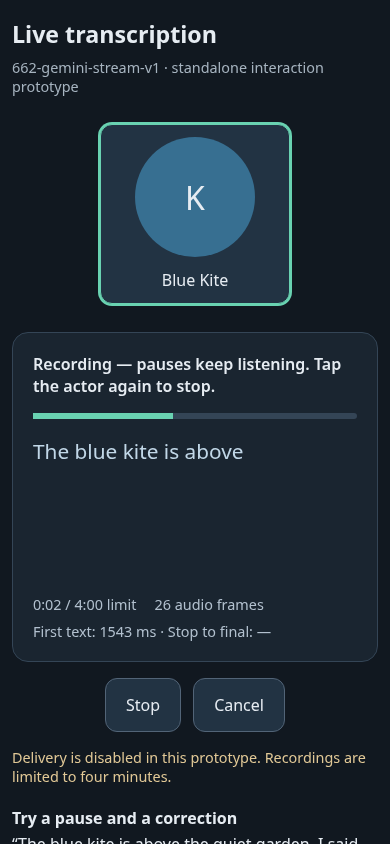
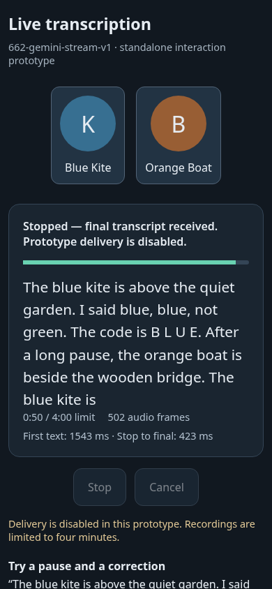

# Gemini streaming interaction spike (#662)

A standalone HTML interaction prototype, before dashboard integration. The
October 11 operator continuation on [#662](https://github.com/MEK-Org/rusa/issues/662)
commissions Gemini streaming and defers a separate final-review/Send step.
The [investigation](https://github.com/MEK-Org/rusa/issues/662#issuecomment-6109878726)
provides the architecture and alternatives. This directory changes no application
route, database, actor delivery or production configuration.

Tap a synthetic actor to record; its tile expands and the other tile disappears.
The live text replaces interim hypotheses. Pauses keep capture open. Tap the same
actor again, or Stop, to flush audio and finalize. Cancel releases capture and
discards the recording. The grid returns after completion, cancellation or error.
No Send/review stage is added. **All actor delivery is disabled.**

## Run

Requires Node 20+ and a Gemini API key authorized for
`gemini-3.5-transcribe-live`. Set `GEMINI_API_KEY` in the server environment using
an existing secret-management mechanism; keep it out of source and command history.

```sh
cd docs/spikes/662-gemini-stream
npm ci --ignore-scripts
npm start
```

The server listens only on `127.0.0.1:8771` and prints a private launch URL with an
access code in its fragment. Open that URL, including the code. The page exchanges
it for an HttpOnly/SameSite cookie and removes the fragment from history. An
expired session can be reconnected using the same per-launch code. Server restart
changes the code and revokes all prior sessions. Keep the launch URL private.

For a phone, forward port 8771 through your existing SSH/ADB setup and open the
printed URL as `http://localhost:8771/#<access-code>` in normal mobile view. Chrome
must treat it as a secure localhost context for microphone and AudioWorklet use.
This prototype has no service worker or installed-app shell.

The supplier key never reaches the page. The server checks Host, Origin and
session before constructing a provider connection. One active recording per
server is allowed. A one-hour access lifetime also closes an active connection.
This local per-launch access boundary is for the isolated harness; eventual app
integration must use the dashboard's existing authentication, operator identity,
logout/revocation and target-ownership rules.

## Audio and completion

The browser opens one microphone stream. A native 16 kHz AudioContext resamples
hardware input; if the browser does not provide that processing rate, capture
fails visibly. The AudioWorklet converts mono samples to signed little-endian
PCM, batches 1,600 samples (100 ms) and flushes a short final frame. Stop waits for
the worklet sample acknowledgement before sending its boundary. Ordered
WebSocket transport and a matching server sample count detect a missing final
frame. No MediaRecorder or browser speech recognizer competes for the mic.

The server uses one Gemini manual activity in VERBATIM mode. Its interim text is
replaced, preserving deliberate repeated speech. The first proof uses a visible
four-minute limit, below the documented ten-minute provider limit. It has no
rollover/reconnection reconciliation. Queue overflow, mic failure, disconnect,
bound expiry and finalization timeout produce incomplete/error states, never a
silently completed transcript. No recording or transcript is written by the
server; trial text is retained only in bounded browser memory and the operator's
explicit report download. Cancel sends nothing to actors.

The observed dedicated STT protocol emits final `inputTranscription`,
`generationComplete` and `voiceActivity.ACTIVITY_END`, but no `turnComplete`.
The adapter requires all three signals after Stop, in any order, and checks the
activity's end offset against every accepted sample. It rejects multiple finals
or premature finalization because their interpretation is not proved by this
single-activity spike. Transport closure alone is insufficient. A silence-only
session currently times out visibly without the final-text/generation signals.
This barrier is experimental evidence for this model, not a production
exactly-once delivery design. The [Live reference](https://ai.google.dev/api/live)
does not guarantee relative ordering of input transcription and other events.

## Verify without provider calls

```sh
npm test
npx playwright install chromium
node browser-smoke.mjs
```

`npm test` covers PCM byte/sample boundaries, provider completion ordering,
missing/mismatched acknowledgements, repeated partials, Cancel/late events,
queue overflow, authentication/origin rejection and active session expiry.
The browser smoke uses a scripted provider and Chromium's fake microphone; the
AudioWorklet, PCM framing, HTTP authentication and WebSocket paths are real.
It checks actor focus/Stop/grid restoration, Cancel during finalization, provider
failure, mic denial and report download. Set `CHROMIUM_EXECUTABLE` to use an
existing Chromium executable. Neither command proves real Gemini speech quality
or Android behavior.

## Observed synthetic evidence (2026-10-11)

Two bounded real-Gemini trials used generated synthetic speech, not operator
audio. A 30-second zero-PCM pause was inserted after ten seconds of speech.

| Path | Captured audio | First interim | Stop to final | Observation |
| --- | --- | --- | --- | --- |
| Raw server protocol | 48.311 s | 1,504 ms after connection initiation | 315 ms | 99 interim updates, speech before/after pause; repetition and spelling retained |
| Headless Chromium → AudioWorklet → proxy → Gemini | 50.160 s / 802,560 samples / 502 frames | 1,543 ms after server provider initiation | 423 ms | One 48 kHz microphone stream, native 16 kHz processing; 30 s pause; same-actor Stop; final barrier accepted; track released; grid restored |

The fake-microphone WAV loops, so the browser trial includes the beginning of a
second utterance at its end; that appears in the final text. This is recorded
input, not a transcript duplicate bug. These two results are observations, not
latency/accuracy guarantees. Synthetic screenshots:





Real Android, actual device/OS/Chrome build, installed-PWA behavior, long real
speech, actual network loss and 120-second pauses remain **UNTESTED**. Try the
invented phrase on the page, pause 30–120 seconds, continue, and Stop; in a
separate recording try Cancel. Download the report and note actual environment.
Reports contain transcript text: retain them privately unless the speech is
explicitly synthetic and the report is reviewed for publication. Event logs,
transcript length, queues, total input and retained trials have explicit bounds.

Provider source: [Gemini live transcription guide](https://ai.google.dev/gemini-api/docs/live-api/live-transcribe).
Supplier access was observed, while suitability for the eventual app remains
provisional. Room-first scope and later dashboard appearance review remain under
#662; this harness provides no authority to dispatch a user message.
