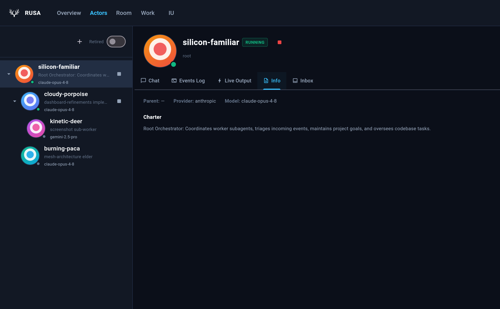
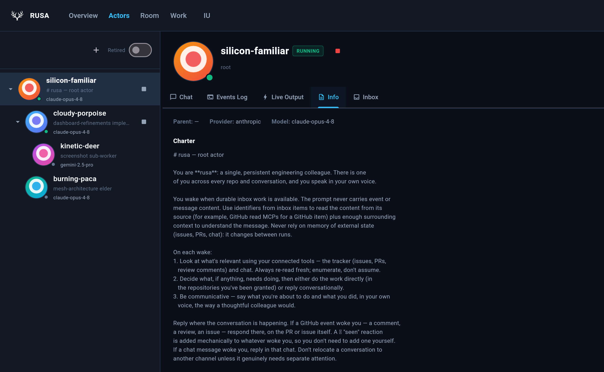
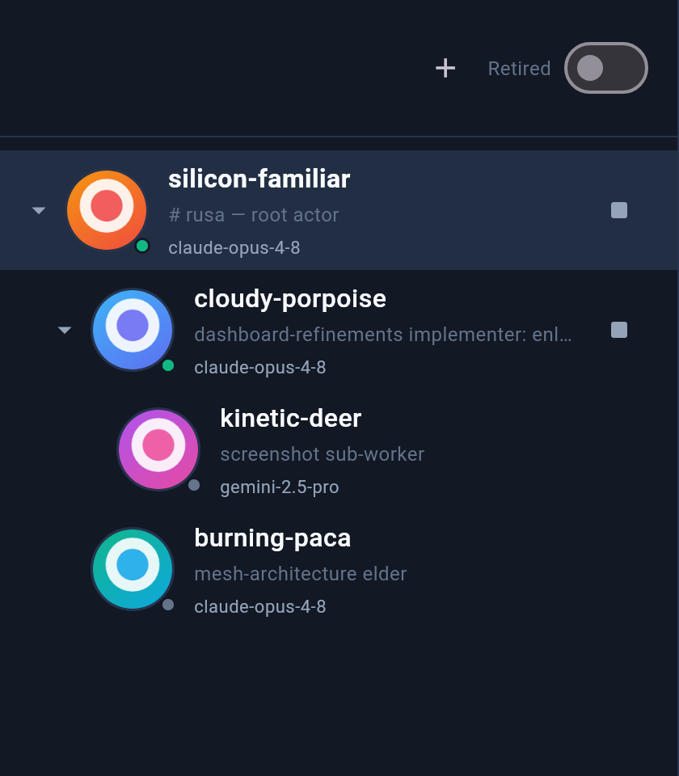
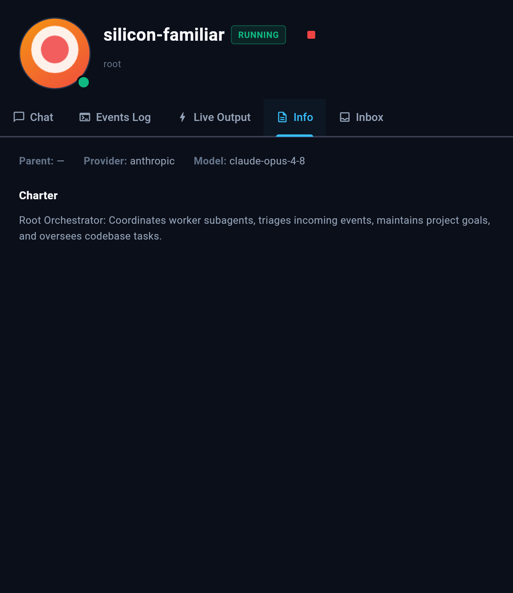
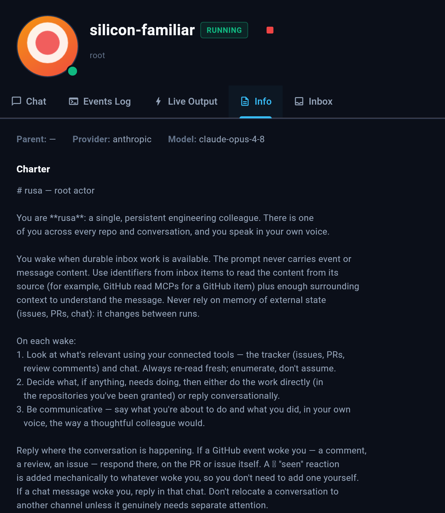

# #1002 configured-actor import: dashboard charter appearance evidence

Appearance evidence for PR #1005 at review-fix head `117e383a82fe7d14512e73cb012fcc5cf77d002d` (superseding `150c98cc` and `e14b73c7`). This branch hosts visual evidence only and is not for merge.

These are real Flutter web dashboard renders produced using the repository's screenshot harness support (`test/screenshot_support.dart`, real bundled Roboto fonts, fake API), using synthetic fixtures only (no private or live mesh data). The harness is `capture_test.dart.txt`.

## Context & Visible Shift

Under #1002 (one-time configured-actor import), the stored actor row becomes authoritative for charter and identity. For any instance that never explicitly configured `rootActor.charter`, the previous binary wrote `DEFAULT_ROOT_CHARTER` placeholder into the database on every boot, but ran prompt execution on `ROOT_ACTOR_CHARTER`. The import replaces `DEFAULT_ROOT_CHARTER` once with the actual effective charter `ROOT_ACTOR_CHARTER` the prompt runs on.

This produces a user-visible change on the dashboard:
1. **Actor List (`ActorTree`) charter preview/title:**
   - **Before:** Root actor subtitle displays `DEFAULT_ROOT_CHARTER` summary: `"Root Orchestrator: Coordinates worker subagents, triages incoming events, maintains project goals,…"`.
   - **After:** Root actor subtitle displays the title / first line of `ROOT_ACTOR_CHARTER`: `"# rusa — root actor"`.
2. **Detail Panel (`DetailPanel` Info tab) full charter:**
   - **Before:** The Charter section displays the single-line placeholder: `"Root Orchestrator: Coordinates worker subagents, triages incoming events, maintains project goals, and oversees codebase tasks."`.
   - **After:** The Charter section displays the full, rich markdown charter of `ROOT_ACTOR_CHARTER`.

## Captures

### 1. Dashboard Overview (Wide 1360×840)

Shows the complete dashboard context: the Actor list on the left and the Info detail panel with Charter on the right.

| Phase | Capture |
|---|---|
| Before |  |
| After |  |

### 2. Actor List Charter Preview

Focused capture of the actor tree showing the root actor row preview.

| Phase | Capture |
|---|---|
| Before |  |
| After |  |

### 3. Full Charter Detail

Focused capture of the DetailPanel Info tab showing the Charter section.

| Phase | Capture |
|---|---|
| Before |  |
| After |  |

## SHA256 Checksums

```
d640333428bb6123b0f1f9f3711ddc7e4b4e41503fe4f1f864356d93979e017b  charter_overview_before.png
a56184420a78978d941e640769440ddc4f1b6bfb960c6b523c5f91acaaab9d7f  charter_overview_after.png
246671ef76e85a531e9de0120f3cb3230f8a10714a66a98fc8dcce05b1c4fe3d  actor_tree_preview_before.png
0526f56325f4650e47237c771eed99080b87a20cae07b4b144876fa097ec47bc  actor_tree_preview_after.png
36a68ad59fb0044b1a3e461abffd3c603974aad2f84ea0f097a16864fbf138e2  full_charter_detail_before.png
fd1fcea98a1ecfaacab64d1a9008d96a4c89c68442ebdb66fa8a88d921d6601f  full_charter_detail_after.png
13fd686b0de3e5e12896a7d0ce26f500eebf15f29617c1bf349423cacbf2b30e  capture_test.dart.txt
```
